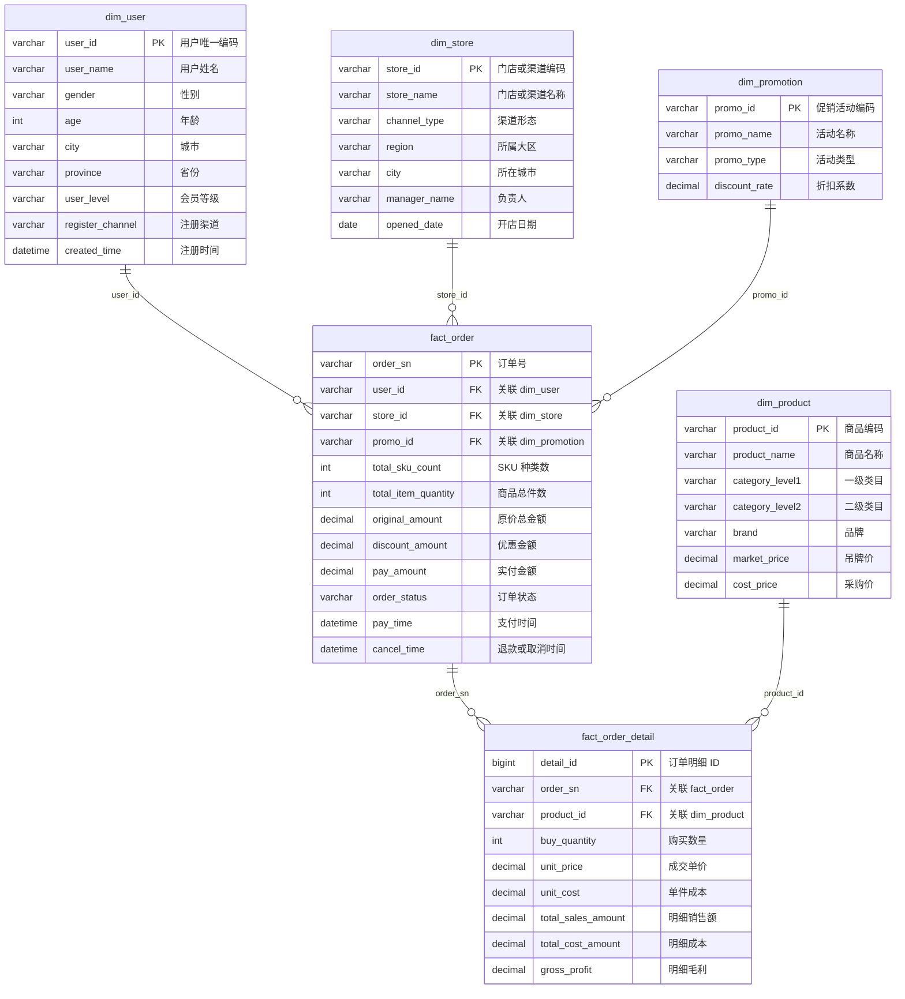

# DW 数仓 ER 图与 Join 约束

本文档描述 `dw` 数据库当前的真实表结构、主外键关系和推荐 Join 路径。它以 [app/tests/init_chinese_dw.py](../app/tests/init_chinese_dw.py) 中的建表 SQL 为准，是后续构建 Meta 元数据、指标血缘和 Text-to-SQL 约束的基础。

> 适用范围：当前电商示例数仓。生产数仓新增、删除或修改表结构后，必须同步更新本文档和元数据知识库。

## 1. ER 图



## 2. 表的粒度与职责

| 表 | 类型 | 粒度 | 核心用途 |
| --- | --- | --- | --- |
| `dim_user` | 用户维度表 | 一位用户一行 | 用户、地域、会员和注册渠道分析 |
| `dim_store` | 门店 / 渠道维度表 | 一个门店或渠道一行 | 大区、城市、渠道和门店分析 |
| `dim_promotion` | 促销维度表 | 一个促销活动一行 | 促销类型、折扣和活动归因 |
| `dim_product` | 商品维度表 | 一个 SKU / 商品一行 | 商品、品牌和类目分析 |
| `fact_order` | 订单主事实表 | 一笔订单一行 | 时间、渠道、用户、状态、订单金额分析 |
| `fact_order_detail` | 订单商品明细事实表 | 一笔订单中的一个商品一行 | 商品销量、品类销售额、成本和毛利分析 |

## 3. 允许的 Join 路径

| 起始表 | 目标表 | Join 条件 | 适用问题 |
| --- | --- | --- | --- |
| `fact_order` | `dim_user` | `o.user_id = u.user_id` | 用户、会员、城市、性别分析 |
| `fact_order` | `dim_store` | `o.store_id = s.store_id` | 大区、门店、渠道分析 |
| `fact_order` | `dim_promotion` | `o.promo_id = p.promo_id` | 促销活动和折扣分析 |
| `fact_order` | `fact_order_detail` | `o.order_sn = d.order_sn` | 同时按订单时间 / 渠道和商品明细分析 |
| `fact_order_detail` | `dim_product` | `d.product_id = p.product_id` | 商品、品牌、品类、毛利分析 |

### 关键约束

1. `fact_order_detail` **没有** `pay_time`、`order_status`、`store_id`、`user_id` 字段。
2. 时间范围、订单状态、门店 / 大区筛选应优先从 `fact_order` 获取。
3. 商品、品牌、类目筛选应通过 `fact_order_detail → dim_product` 获取。
4. 同时按“时间 / 大区”和“商品 / 品类”分析时，必须经过 `fact_order.order_sn = fact_order_detail.order_sn`。
5. 当前日期字段名是 `pay_time`，不是 `order_date`。

## 4. 典型查询模式

### 4.1 上个月华东区销售额

此问题处于订单粒度，使用实付金额和支付时间：

```sql
SELECT SUM(o.pay_amount) AS total_sales
FROM fact_order AS o
JOIN dim_store AS s
  ON o.store_id = s.store_id
WHERE s.region = '华东'
  AND o.order_status IN ('已完成', '已发货')
  AND o.pay_time >= '2026-08-01'
  AND o.pay_time < '2026-09-01';
```

> 是否将退款、待付款、已取消订单计入销售额，属于业务口径决策，不能由模型自行猜测。

### 4.2 上个月华东区各品类销售额

此问题同时需要订单时间 / 大区与商品类目，必须连接订单主表、订单明细表、门店维度和商品维度：

```sql
SELECT
  p.category_level1,
  SUM(d.total_sales_amount) AS category_sales
FROM fact_order AS o
JOIN dim_store AS s
  ON o.store_id = s.store_id
JOIN fact_order_detail AS d
  ON o.order_sn = d.order_sn
JOIN dim_product AS p
  ON d.product_id = p.product_id
WHERE s.region = '华东'
  AND o.order_status IN ('已完成', '已发货')
  AND o.pay_time >= '2026-08-01'
  AND o.pay_time < '2026-09-01'
GROUP BY p.category_level1
ORDER BY category_sales DESC;
```

## 5. 对 Data Agent 的影响

这个 ER 图应成为以下能力的结构化约束来源：

| Agent 能力 | 应使用的 ER 信息 |
| --- | --- |
| Schema Retrieval | 表、字段、字段所属表 |
| Value Retrieval | `region`、`order_status`、品牌、类目等枚举字段 |
| 指标血缘 | 指标依赖的度量字段与必要 Join 路径 |
| SQL Generation | 真实字段白名单和允许 Join 条件 |
| SQL Self-correction | 不存在字段时反查字段所属表和正确 Join 路径 |
| SQL Validation | 禁止使用未定义字段、无 Join 条件或错误关联 |

在 `column_metric` 写入关系前，先根据本图和 [BUSINESS_RULES.md](BUSINESS_RULES.md) 确认指标依赖字段。例如：

```text
销售额（订单口径）
  → fact_order.pay_amount

商品销售额
  → fact_order_detail.total_sales_amount

商品毛利
  → fact_order_detail.gross_profit

客单价（订单口径）
  → fact_order.pay_amount
  → fact_order.order_sn
```

## 6. 当前缺口

数据库 DDL 已有真实外键，但当前 Meta 知识库尚未显式保存“表—表 Join 关系”。这会让模型依赖 Prompt 和 Few-shot 猜测关联路径。

在写入 `column_metric` 后，下一步应新增独立的表关系元数据，例如：

```text
source_table / source_column
target_table / target_column
relation_type
```

这样在线 Agent 才能把 ER 图中的约束带入 SQL 生成与 SQL 修复流程。

最后更新：2026-09-15
