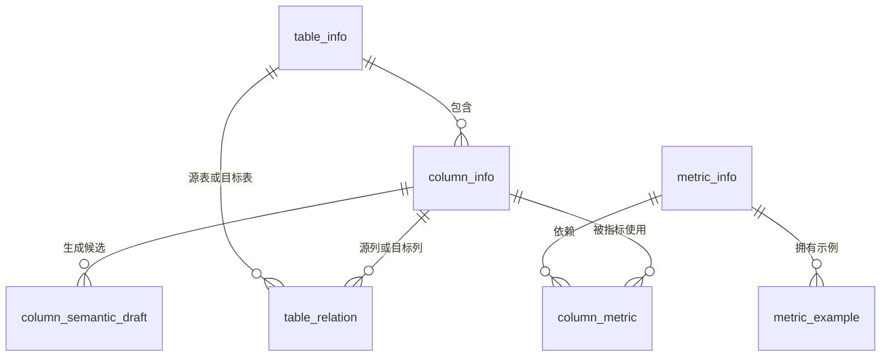

# Meta 数据库设计说明

`meta` 是智能问数系统的控制平面，不保存订单、商品等业务事实数据；真实业务数据仍位于 `dw`。它保存已经确认的 Schema、表关系和指标定义，为数据发现、SQL 生成、SQL 校验与指标解释提供共同依据。

## 1. 初始化方式

在项目根目录执行：

```bash
python -m app.scripts.init_meta_database
```

该脚本使用 SQLAlchemy 的 `create_all` 幂等创建表：表不存在时创建，已存在时不删除、不覆盖数据。运行前须在 `.env` 填写有效的 `DB_META_*` 配置。

创建 Meta 空表后，执行 DW Schema 同步：

```bash
python -m app.scripts.sync_dw_schema_to_meta
```

同步器只写入或更新 DW 中可验证的物理事实：表名、字段名、字段类型、主键、外键和字段级 Join 关系。它不会覆盖人工维护的表描述、字段描述、别名、样例值、指标或示例。

字段业务语义采用“模型推导候选 → 人工审核 → 发布”的治理闭环。模型只写
`column_semantic_draft`，只有审核通过才会更新 `column_info`。命令和规则见：
[COLUMN_SEMANTIC_GOVERNANCE.md](COLUMN_SEMANTIC_GOVERNANCE.md)。

## 2. 与 DW 的职责边界

```text
dw：真实业务事实
  ├─ fact_order、fact_order_detail
  └─ dim_user、dim_store、dim_product、dim_promotion

meta：智能问数控制平面
  ├─ 已探查的表与字段
  ├─ 已确认的 Join 关系
  ├─ 已发布的指标口径
  └─ 指标与字段的血缘、示例
```

真实 DW 的 ER 图见：[DW_ERD.md](DW_ERD.md)。业务口径见：[BUSINESS_RULES.md](BUSINESS_RULES.md)。

## 3. 表清单

| 表 | 职责 | 数据来源 |
| --- | --- | --- |
| `table_info` | 已探查的 DW 表及其描述 | 从 DW Schema 探查；描述可经人工审核 |
| `column_info` | 已探查的 DW 字段、类型、角色、样例和同义词 | 从 DW Schema 探查；语义可经人工审核 |
| `column_semantic_draft` | 字段业务语义的模型候选，等待人工审核 | 模型生成；审核通过后发布回 `column_info` |
| `table_relation` | 已确认的表间 Join 关系 | 从 DW 外键 / DDL 解析后人工确认 |
| `metric_info` | 指标定义、公式、状态和第一版配置 | 业务人员创建，数据人员校验后发布 |
| `column_metric` | 指标公式依赖的核心字段血缘 | 根据已发布指标写入 |
| `metric_example` | 指标的正确 / 错误示例 | 人工维护，用于解释、测试与 Few-shot |

## 4. 表关系



## 5. 各表字段设计

### `table_info`

保存 DW 物理表。`name` 唯一，例如 `fact_order`；`role` 表示事实表或维度表；`description` 为业务说明。

### `column_info`

保存字段且通过 `table_id → table_info.id` 归属到表。`(table_id, name)` 唯一，避免同一表下重复字段。`role` 可取 `primary_key`、`foreign_key`、`measure`、`dimension`。

`column_info` 只保存已经审核通过、可信的字段业务语义。模型推导的候选内容统一
放在 `column_semantic_draft` 中，避免一次模型幻觉直接污染在线 Agent 的检索和
SQL 生成上下文。

### `column_semantic_draft`

保存模型为单个字段推导的候选描述、候选别名和真实枚举样例，初始状态为
`pending`。审核动作只有 `approved` 或 `rejected`；审核通过时，服务把审核后内容
写回 `column_info`，并把实际写入内容记录在 `published_content`，形成可审计链路。

### `table_relation`

保存被允许使用的字段级 Join。例如：

```text
fact_order.store_id = dim_store.store_id
fact_order.order_sn = fact_order_detail.order_sn
fact_order_detail.product_id = dim_product.product_id
```

这张表是 SQL 生成与 SQL 修复的重要约束来源，不能由模型在运行时自由编造。

### `metric_info`

保存第一版指标配置。核心字段包括：

```text
metric_key：稳定英文标识，例如 sales_amount
name：中文指标名称，例如 销售额
description：业务口径说明
formula：公式文本
fact_table：主事实表
measure_column：核心度量字段
aggregation：聚合方式
time_column：默认时间字段
filters：固定过滤条件 JSON
alias：别名 JSON
dimensions：允许分析维度 JSON
status：draft / published / deprecated
version：版本号
```

为控制初版复杂度，`filters`、`alias`、`dimensions` 暂使用 JSON。指标数量、审批流程和查询复杂度显著增加后，可拆为独立关系表。

### `column_metric`

这是指标—字段的多对多关系表，只保存**公式计算直接依赖**的字段。例如：

```text
销售额 → fact_order.pay_amount
订单数量 → fact_order.order_sn
```

时间字段、固定过滤字段和可分析维度不等于公式血缘，第一版不写入本表。

### `metric_example`

保存 `correct` 和 `wrong` 两类示例：问题、SQL 或解释文本、以及正确或错误的原因。它可支持指标解释、回归测试和后续 Few-shot 检索。

## 6. 初版数据流

```text
DW Schema
  ↓ 探查
table_info / column_info / table_relation
  ↓ 业务人员配置并发布指标
metric_info / column_metric / metric_example
  ↓ 构建向量索引
Qdrant
  ↓
Data Agent：指标解释、数据发现、Text-to-SQL
```

初始指标资产（销售额、订单数量）的发布口径和命令见：[INITIAL_BUSINESS_ASSETS.md](INITIAL_BUSINESS_ASSETS.md)。

后续业务人员可以在 Web 页面「元数据管理 → 指标管理」中提交新指标。提交时系统会校验
事实表、度量字段、时间字段、过滤字段和维度字段是否真实存在，校验通过后写入
`metric_info.status = published`，并自动生成 `column_metric` 公式血缘。指标口径
由业务人员负责，因此第一版不做人工审批，但保留系统级技术校验。

## 7. 第一版边界

当前仅搭建可维护、可扩展的骨架：

- 有真实 Schema、Join 关系、指标和字段血缘的分层模型。
- 支持后续“销售额”“订单数量”两个指标的配置和发布。
- 保留 `draft / published / deprecated` 状态，在线 Agent 后续只读取 `published` 指标。

当前不实现：登录鉴权、多级审批、历史版本生效区间、复杂指标依赖图、完整管理后台。它们在核心 Agent 和评测链路稳定后再迭代。

最后更新：2026-09-16
