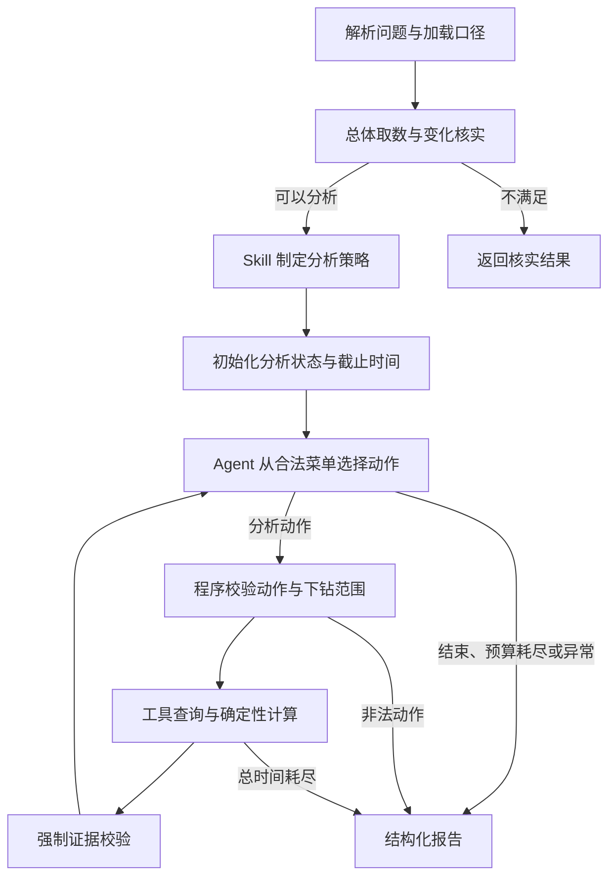

# 异动分析第一版：LangGraph + Skill + Tools + 受约束的 ReAct

## 业务范围与设计

只支持已发布销售额指标的相邻完整月份环比下降；允许总体分析以及合法的地区、渠道等筛选。
先复用已有请求解析、指标口径、总体取数与变化核实，不将这些前置步骤交给模型自由选择。
核实通过后由 SalesAmountMomDeclineSkill（1.2）给出候选维度与指标拆解许可。



ReAct 在这里指“根据观察选择动作、调用工具、取得观察并继续”，通过结构化动作实现，不要求输出长篇思维过程。
约束由程序实现，提示词只负责引导，不能替代执行门禁。

## 文件职责与修改

| 文件 | 职责与变化 |
| --- | --- |
| `app/agent/anomaly_agent/preparation_agent/graph.py` | AnomalyPreparationAgent：解析、指标上下文、总体查询、变化核验 |
| `app/agent/anomaly_agent/Main_RootCause/` | Main_RootCause 主节点的专属节点、工具和 Skill |
| `app/agent/anomaly_agent/graph.py` | 连接前置 Agent 与 Main_RootCause；变化核验失败时结束 |
| `app/agent/anomaly_agent/Main_RootCause/nodes/analyze_change.py` | 原单节点 for 循环改为六个节点：初始化、决策、动作校验、执行、证据校验、报告；保留直接调用兼容入口 |
| `app/agent/anomaly_agent/state.py` | 保存截止时间、候选维度、动作历史、校验后的观察，以及当前动作与工具结果 |
| `schemas.py` | 扩展动作类型、允许拆解标记、拆解结果、完成状态和结果局限；拆解模型从 handler 移至共享契约以避免循环依赖 |
| `app/agent/anomaly_agent/Main_RootCause/skills/sales_amount_mom_decline.py` | 根据请求、实际变化和元数据制定策略；没有已发布拆解关系时不开放拆解 |
| `app/agent/anomaly_agent/Main_RootCause/skills/base.py` | 校验 Skill 策略不越界 |
| `app/agent/anomaly_agent/Main_RootCause/tools/scope_planning.py` | 构造合法动作菜单，恢复真实分组的累积筛选；加入按范围判重的拆解动作 |
| `app/agent/anomaly_agent/Main_RootCause/tools/dimension_contribution.py` | 沿用现有维度取数与贡献计算，不改变实现 |
| `app/agent/anomaly_agent/Main_RootCause/tools/metric_decomposition.py` | 沿用已发布公式的取数、两因素对称分摊；模型类型改为从共享契约导入 |
| `prompts/anomaly/decide_action.prompt` | 允许调用已发布指标拆解，仍禁止自由公式、SQL 和筛选 |
| `tests/test_react_graph.py` | 新增多工具状态流转、证据拒绝、下钻拆解和检查点回归 |
| `tests/run_analyze_change.py` | 真实链路入口；支持问题、总超时参数与运行耗时 |
| `pyproject.toml` / `uv.lock` | 声明 SQLAlchemy asyncio extra；补齐锁文件已有且 Embedding 使用的 langchain-community、zhipuai 依赖 |

表中相对文件均位于 `app/agent/anomaly_agent/` 下，另有标注的项目根文件除外。

## 决策与证据

动作只有 dimension_contribution、metric_decomposition、finish。下钻不单设自由查询工具，
而是通过 scope_ref 引用先前成功的维度分组，由程序恢复筛选和两期基准。
模型不能修改原指标、月份、原筛选或生成可直接执行的 SQL。

维度证据：两期分组分别与当前范围基准对账，重新计算差额和贡献率，检查两期 SQL 证据存在。
拆解证据：核对 request_id、指标、周期与筛选；根据数量原值重新计算两因素结果并比较。
失败观察清除贡献与拆解明细，不作为下一步可下钻的证据。
零分母等条件返回 unavailable，不伪装成零贡献或成功结果。

拆解使用数量 × 平均金额，变化交互项各分一半。这是一个分摊约定，不证明因果。
分组贡献的分母是当前范围净变化，可为负或超过 100%。
不同维度、父子范围以及维度贡献与公式拆解结果，均不可直接相加。

## 预算、兼容与恢复

保留三轮模型决策（finish 也计一轮）、分析阶段 240 秒、单次决策 45 秒、单工具 90 秒、最大下钻深度 2。
所有等待受剩余总预算约束。总体取数和请求解析不在这 240 秒内，CLI 另有默认 420 秒整体超时。
每个工具最多发起两个周期取数任务；底层 Text-to-SQL 的模型调用、EXPLAIN 与重试仍按原链路执行，
因此三轮限制不等于物理 SQL 次数、Token 或金额的硬预算。
不改变现有 Session 使用方式：维度、拆解工具的两期请求顺序执行，避免共享 Meta Session 的并发问题。

保留 change_analysis_report、analysis_action、analysis_observation 与最终 token 事件。
新增字段是可选扩展；未修改 API 和前端。报告仍采用确定性模板，第一版没有额外 LLM 润色调用。
completion_status=completed 只表示模型正常结束、有有效明细且已执行动作均成功，
不表示完整遍历所有维度或已经证明根因。预算耗尽、失败、无有效明细均标记 partial。

State 按节点写回，支持部署层注入 checkpointer。测试使用 InMemorySaver 验证逐节点检查点。
默认实例未配置持久存储，因此不宣称跨进程恢复。使用检查点续跑时保存原绝对截止时间，不重置预算。
工具调用中断后的重试可能重新取数，应使用固定数据快照与查询去重；第一版没有实现 exactly-once。

## 验证与运行

```bash
.venv/bin/python -m unittest app.agent.anomaly_agent.tests.test_analyze_change_unit app.agent.anomaly_agent.tests.test_drilldown_unit app.agent.anomaly_agent.tests.test_metric_decomposition_tool app.agent.anomaly_agent.tests.test_react_graph app.tests.test_metric_decomposition_unit app.tests.test_value_grounding_unit

.venv/bin/python -m app.agent.anomaly_agent.tests.run_analyze_change --question '为什么2025年7月上海销售额比2025年6月下降了？' --timeout 420
```

真实联调读取现有环境配置并调用模型、MySQL、Qdrant 和 Elasticsearch。不要把密钥写入测试或文档。

## 当前水平与下一步

这是可测试、受约束的工程原型，不是已经验证业务正确率的生产系统。
数值对账与 SQL 存在检查不能证明筛选语义、权限、关联粒度及数据完整性正确。
工具仍通过自然语言调用现有 Text-to-SQL；生产升级需要结构化取数契约、SQL 语义约束、数据库只读权限、
行级权限、服务端超时/扫描配额，以及跨查询快照一致性。不要把 Agent 动作白名单当成数据库权限控制。

下一步固定评测集，比较当前维度基线与多工具版本的有效证据正确率、关键驱动覆盖、无依据因果断言、
P95 延迟、模型与 SQL 调用次数、Token 和成本。当前单元测试通过不代表这些业务指标已经提高。

代码阅读顺序：schemas/state → Skill → scope_planning → 子图 → tools → tests。
建议自己重新实现一次“按真实分组恢复下钻范围”的逻辑。

面试练习：为什么证据校验必须由图强制执行？为什么对账通过仍不能证明 SQL 正确？
检查点如何影响重复查询与时间预算？先回答这三题，再结合实现解释取舍。
